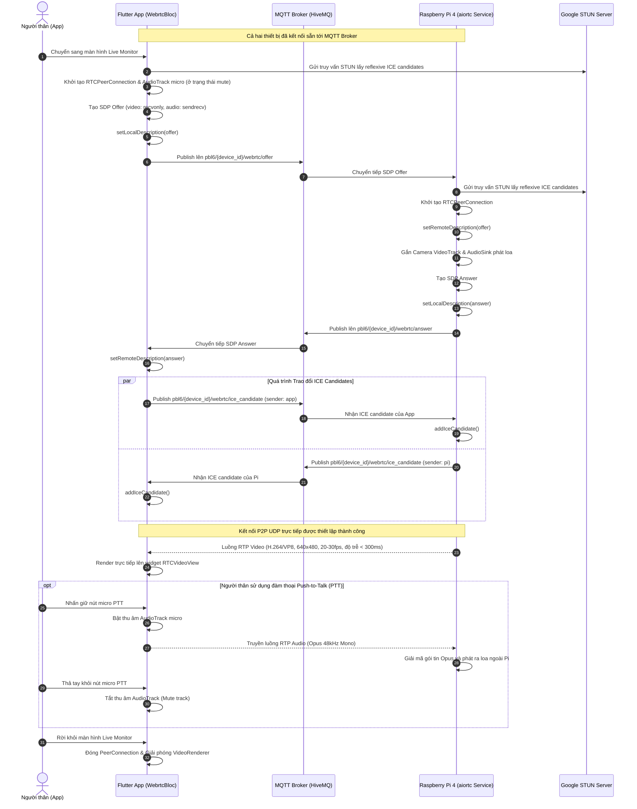

# Kiến trúc Hệ thống & Đặc tả Giao thức PBL6 Assistive Monitor

Tài liệu này đặc tả toàn bộ kiến trúc tổng thể, mô hình phân tầng Clean Architecture cho ứng dụng di động Flutter, đặc tả giao thức MQTT (chủ đề, chất lượng dịch vụ QoS, cấu trúc bản tin JSON) và quy trình báo hiệu (signaling) WebRTC phục vụ truyền phát video trực tiếp và đàm thoại hai chiều Push-To-Talk giữa thiết bị đeo Raspberry Pi 4 (hoặc Mock Pi) và ứng dụng di động của người thân.

---

## 1. Tổng quan Hệ sinh thái & Sơ đồ Thành phần (System Architecture)

Hệ thống vận hành theo mô hình phân tán Edge - Cloud - Mobile với 3 thành phần cốt lõi:

1. **Edge Layer (Raspberry Pi 4 / Mock Pi)**:
   - Thu thập tín hiệu cảm biến siêu âm HC-SR04 đo khoảng cách vật cản thời gian thực.
   - Thu hình ảnh camera POV và chạy suy luận cục bộ (YOLOv8n) phát hiện vật thể nguy hiểm (bậc tam cấp, hố trũng, chướng ngại vật).
   - Phát cảnh báo âm thanh trực tiếp vào tai nghe người đeo với độ trễ tối thiểu (không phụ thuộc kết nối Internet).
   - Định kỳ đẩy dữ liệu đo xa (telemetry) và phát cảnh báo nguy cấp qua kênh MQTT.
   - Đóng vai trò WebRTC Peer: mã hóa và truyền luồng video từ camera, đồng thời nhận luồng âm thanh micro từ điện thoại phát ra loa ngoài.

2. **Cloud Infrastructure (MQTT Broker & Google STUN)**:
   - **MQTT Broker (`broker.hivemq.com:1883`)**: Kênh điều phối trung tâm nhẹ, tin cậy, phụ trách truyền nhận telemetry, cảnh báo sự cố, đồng bộ cấu hình, lệnh điều khiển phần cứng và làm kênh báo hiệu (Signaling) cho WebRTC.
   - **Google STUN Server (`stun:stun.l.google.com:19302`)**: Hỗ trợ duyệt NAT (Session Traversal Utilities for NAT), giải quyết địa chỉ IP/Port công khai để thiết lập kết nối P2P trực tiếp giữa điện thoại và Raspberry Pi 4.

3. **Mobile Client Layer (Flutter Android App)**:
   - Thiết kế theo mô hình Clean Architecture và quản lý trạng thái bằng BLoC.
   - Kết nối liên tục tới MQTT Broker để cập nhật thông số cảm biến trên màn hình Dashboard.
   - Tiếp nhận sự kiện cảnh báo từ Pi và kích hoạt thông báo nổi (Heads-up Notification) mức ưu tiên cao kèm âm thanh và rung mạnh.
   - Hiển thị luồng video WebRTC thời gian thực với độ trễ dưới 300ms trên màn hình Live Monitor.
   - Cung cấp nút bấm Push-to-Talk (PTT) thu âm micro truyền về loa Pi khi người thân muốn hướng dẫn người khiếm thị bằng giọng nói.

### Sơ đồ Khối Thành phần Hệ thống (Mermaid Component Diagram)

```mermaid
graph TB
    subgraph Edge["Edge Layer (Raspberry Pi 4 / Mock Server)"]
        Sensors["Cảm biến & Ngoại vi<br/>(HC-SR04, Camera POV, Pin, Nhiệt độ)"]
        AudioEdge["Âm thanh đầu ra<br/>(Tai nghe cục bộ, Loa ngoài, Còi buzzer)"]
        EdgeApp["Pi Edge Service (Python)<br/>aiortc + paho-mqtt + opencv"]
        Sensors -->|Dữ liệu thô| EdgeApp
        EdgeApp -->|Cảnh báo tức thì| AudioEdge
    end

    subgraph Cloud["Cloud Infrastructure (Miễn phí)"]
        Broker["MQTT Broker<br/>(broker.hivemq.com:1883)"]
        STUN["STUN Server<br/>(stun:stun.l.google.com:19302)"]
    end

    subgraph Client["Mobile Client Layer (Flutter Android App)"]
        subgraph Presentation["Presentation Layer"]
            UI["Screens (Dashboard, Live Monitor, Settings, History)"]
            Blocs["BLoCs (Connection, Dashboard, Alert, Config, WebRTC)"]
            UI <--> Blocs
        end
        subgraph Domain["Domain Layer"]
            Entities["Entities (Telemetry, Alert, DeviceConfig)"]
            RepoContracts["Repository Interfaces"]
        end
        subgraph Data["Data Layer"]
            RepoImpl["Repository Implementations"]
            DataSources["DataSources (MqttDatasource, WebrtcDatasource)"]
            RepoImpl --> DataSources
        end
        subgraph Core["Core Layer"]
            Services["NotificationService (Heads-up)"]
            Constants["Constants & AppTheme"]
        end
        Blocs --> RepoContracts
        RepoImpl --> RepoContracts
        DataSources --> Services
    end

    %% Tương tác mạng
    EdgeApp <==>|MQTT: Telemetry, Alert, Config, Command, LWT Status| Broker
    Broker <==>|MQTT: Topics pbl6/{device_id}/...| DataSources
    EdgeApp <==>|Signaling: SDP Offer/Answer & ICE Candidates| Broker
    EdgeApp -.->|Truy vấn NAT Reflexive Candidates| STUN
    DataSources -.->|Truy vấn NAT Reflexive Candidates| STUN
    EdgeApp ===>|WebRTC P2P Video RTP Stream (<300ms)| DataSources
    DataSources ===>|WebRTC P2P Audio PTT RTP Stream (Opus 48kHz)| EdgeApp
```

---

## 2. Đặc tả Kiến trúc Phần mềm Flutter (Clean Architecture)

Mã nguồn ứng dụng Flutter tuân thủ kiến trúc Clean Architecture phân tách rõ 4 tầng độc lập:

```
lib/
├── main.dart
├── core/
│   ├── constants/
│   │   └── app_constants.dart
│   ├── services/
│   │   └── notification_service.dart
│   └── theme/
│       └── app_theme.dart
├── data/
│   ├── datasources/
│   │   ├── mqtt_datasource.dart
│   │   └── webrtc_datasource.dart
│   ├── models/
│   │   ├── telemetry_model.dart
│   │   ├── alert_model.dart
│   │   └── device_config_model.dart
│   └── repositories/
│       ├── telemetry_repository_impl.dart
│       ├── alert_repository_impl.dart
│       └── config_repository_impl.dart
├── domain/
│   ├── entities/
│   │   ├── telemetry_entity.dart
│   │   ├── alert_entity.dart
│   │   └── device_config_entity.dart
│   └── repositories/
│       ├── telemetry_repository.dart
│       ├── alert_repository.dart
│       └── config_repository.dart
└── presentation/
    ├── bloc/
    │   ├── connection/
    │   ├── dashboard/
    │   ├── alerts/
    │   ├── config/
    │   └── webrtc/
    ├── screens/
    │   ├── home_dashboard_screen.dart
    │   ├── live_monitor_screen.dart
    │   ├── settings_screen.dart
    │   └── alert_history_screen.dart
    └── widgets/
        ├── battery_indicator.dart
        ├── ptt_mic_button.dart
        └── alert_banner_widget.dart
```

### 2.1. Phân định Trách nhiệm Các Tầng

1. **`core/` (Hạ tầng dùng chung)**:
   - `app_constants.dart`: Chứa địa chỉ broker (`broker.hivemq.com`), port (`1883`), `device_id` mặc định (`pi4_01`), STUN server (`stun:stun.l.google.com:19302`), định danh topic và ngưỡng mặc định.
   - `notification_service.dart`: Khởi tạo và cấu hình `flutter_local_notifications`. Định nghĩa notification channel mức ưu tiên cao (`high_importance_channel`) kèm cờ heads-up, âm thanh cảnh báo và mẫu rung để hiển thị thông báo nguy cấp đè lên mọi ứng dụng.
   - `app_theme.dart`: Định nghĩa bảng màu (primary blue, alert red, warning amber, dark background cho khung nhìn camera POV) và kiểu chữ chuẩn Unicode tiếng Việt.

2. **`data/` (Tầng dữ liệu)**:
   - `datasources/mqtt_datasource.dart`: Đóng gói `MqttServerClient`. Xử lý vòng đời kết nối, gửi nhận keep-alive, tự động kết nối lại, đăng ký (subscribe) các topic `telemetry`, `alert`, `config`, `status`, `webrtc/*` và xuất luồng `Stream` dữ liệu thô.
   - `datasources/webrtc_datasource.dart`: Khởi tạo và quản lý `RTCPeerConnection`, `RTCVideoRenderer`, cấu hình STUN, tạo offer/answer, xử lý ICE candidates và quản lý bật/tắt audio track cho nút Push-To-Talk.
   - `models/`: Các lớp chuyển đổi JSON (`fromJson`, `toJson`) kế thừa từ các Entity của domain layer.
   - `repositories/`: Triển khai các interface từ domain layer, chuyển đổi model sang entity, xử lý lưu trữ tạm bộ nhớ và điều phối luồng dữ liệu.

3. **`domain/` (Tầng nghiệp vụ cốt lõi)**:
   - Chứa các `Entities` thuần túy không phụ thuộc framework (không phụ thuộc flutter hay thư viện bên ngoài).
   - Chứa các hợp đồng trừu tượng (`Repositories interfaces`) quy định các hàm và Stream mà presentation layer có thể gọi.

4. **`presentation/` (Tầng giao diện & Quản lý trạng thái BLoC)**:
   - **`ConnectionBloc`**: Quản lý trạng thái kết nối MQTT (`Disconnected`, `Connecting`, `Connected`, `Reconnecting`, `Error`) và giám sát trạng thái online/offline của thiết bị Pi qua LWT.
   - **`DashboardBloc`**: Lắng nghe `telemetryStream`, lưu trữ chỉ số mới nhất (khoảng cách siêu âm, dung lượng pin, nhiệt độ chip, trạng thái camera, mức âm lượng) phục vụ vẽ giao diện Dashboard.
   - **`AlertBloc`**: Lắng nghe `alertStream`, kích hoạt thông báo nổi qua `NotificationService`, duy trì danh sách lịch sử cảnh báo theo thứ tự thời gian và hỗ trợ đóng/xóa cảnh báo.
   - **`ConfigBloc`**: Quản lý giá trị cấu hình ngưỡng khoảng cách (`distance_threshold_cm`), âm lượng loa (`speaker_volume`), xuất bản cấu hình mới hoặc gửi lệnh điều khiển (`REBOOT`, `MUTE`, `UNMUTE`, `TRIGGER_BUZZER`) qua MQTT.
   - **`WebrtcBloc`**: Điều phối phiên WebRTC (`idle`, `connecting`, `connected`, `failed`), quản lý trạng thái nút bấm Push-to-Talk (`pttInactive`, `pttActive`), và xử lý thu hồi tài nguyên khi thoát màn hình Live Monitor.

---

## 3. Đặc tả Giao thức MQTT (Topics & Data Schemas)

Quy ước đặt tên topic sử dụng tiền tố: `pbl6/{device_id}/...`  
Trong đó `{device_id}` là mã định danh duy nhất của thiết bị (mặc định: `pi4_01`).  
Broker công cộng thử nghiệm: `broker.hivemq.com`, Port: `1883`.

### Bảng Tổng hợp Danh mục Topic MQTT

| Topic | Hướng truyền | Tần suất | QoS | Cờ Retain | Mục đích |
|---|---|---|---|---|---|
| `pbl6/{device_id}/telemetry` | Pi -> App | Định kỳ 3-5 giây | 0 | False | Cập nhật thông số vận hành thiết bị |
| `pbl6/{device_id}/alert` | Pi -> App | Tức thì khi có sự cố | 1 | False | Phát cảnh báo nguy hiểm khẩn cấp |
| `pbl6/{device_id}/config` | App <-> Pi | Khi thay đổi cấu hình | 1 | True | Đồng bộ tham số cấu hình thiết bị |
| `pbl6/{device_id}/command` | App -> Pi | Theo thao tác người dùng | 1 | False | Gửi lệnh thực thi phần cứng tức thì |
| `pbl6/{device_id}/status` | Pi/Broker -> App | Khi kết nối / mất kết nối | 1 | True | Giám sát trạng thái Online/Offline (LWT) |
| `pbl6/{device_id}/webrtc/offer` | App -> Pi | Khi mở xem Live Video | 1 | False | Truyền SDP Offer khởi tạo WebRTC |
| `pbl6/{device_id}/webrtc/answer` | Pi -> App | Phản hồi sau khi nhận Offer | 1 | False | Truyền SDP Answer thiết lập WebRTC |
| `pbl6/{device_id}/webrtc/ice_candidate` | Hai chiều | Trong giai đoạn bắt tay | 1 | False | Trao đổi địa chỉ mạng ICE candidates |

---

### 3.1. Topic Telemetry: `pbl6/{device_id}/telemetry`
- **Mô tả**: Báo cáo tình trạng phần cứng và dữ liệu cảm biến định kỳ.
- **QoS**: 0 (Fire and forget, chấp nhận rớt gói đơn lẻ vì dữ liệu được làm mới liên tục).
- **Cờ Retain**: `false`.
- **Đặc tả trường dữ liệu**:
  - `device_id` (string): Mã định danh phần cứng Pi 4.
  - `timestamp` (integer): Thời gian ghi nhận tính bằng giây Unix epoch.
  - `battery_percentage` (integer): Mức pin thiết bị (0 - 100%).
  - `temperature_celsius` (float): Nhiệt độ CPU của Pi 4 tính theo độ C.
  - `cpu_usage` (float): Tỷ lệ tải CPU hiện tại (0.0 - 100.0%).
  - `ultrasonic_distance_cm` (float): Khoảng cách đo được từ cảm biến siêu âm tính bằng cm. Giá trị âm `-1.0` thể hiện cảm biến lỗi hoặc vật cản vượt ngoài tầm đo (>400cm).
  - `camera_active` (boolean): `true` nếu camera đang sẵn sàng thu hình, `false` nếu camera gặp lỗi.
  - `speaker_volume` (integer): Âm lượng loa ngoài hiện tại của thiết bị (0 - 100%).

```json
{
  "device_id": "pi4_01",
  "timestamp": 1732312000,
  "battery_percentage": 85,
  "temperature_celsius": 48.5,
  "cpu_usage": 32.0,
  "ultrasonic_distance_cm": 145.2,
  "camera_active": true,
  "speaker_volume": 80
}
```

---

### 3.2. Topic Cảnh báo Sự cố: `pbl6/{device_id}/alert`
- **Mô tả**: Kích hoạt cảnh báo khẩn cấp khi người khiếm thị gặp chướng ngại vật sát gần hoặc phát hiện các nguy cơ té ngã.
- **QoS**: 1 (At least once, đảm bảo bắt buộc ứng dụng phải nhận được cảnh báo an toàn).
- **Cờ Retain**: `false`.
- **Đặc tả trường dữ liệu**:
  - `event_id` (string): Mã định danh duy nhất của sự kiện cảnh báo (ví dụ `"evt_9981"`).
  - `timestamp` (integer): Thời điểm phát sinh cảnh báo (Unix epoch tính bằng giây).
  - `alert_type` (string enum): Phân loại hiểm họa:
    - `OBSTACLE_DANGER`: Vật cản ở cự ly nguy hiểm dưới ngưỡng cho phép.
    - `DROP_OFF_STAIRS`: Phát hiện bậc thang đi xuống hoặc miệng hố trũng.
    - `VEHICLE_APPROACHING`: Phương tiện giao thông đang lao tới nhanh.
    - `SYSTEM_OVERHEAT`: Nhiệt độ phần cứng Pi vượt quá 80°C.
    - `LOW_BATTERY`: Pin thiết bị dưới mức 15%.
  - `level` (string enum): Mức độ khẩn cấp (`CRITICAL`, `WARNING`, `INFO`):
    - `CRITICAL`: Nguy cấp tức thì (khoảng cách < 50cm hoặc bậc thang); ứng dụng rung dồn dập, phát âm thanh cảnh báo và hiện banner heads-up.
    - `WARNING`: Nguy cơ tiềm ẩn (khoảng cách 50 - 100cm); hiện banner thông báo.
    - `INFO`: Thông tin vận hành.
  - `distance_cm` (float): Khoảng cách cụ thể đến vật cản tính bằng cm.
  - `detected_objects` (array of string): Danh sách các nhãn vật thể AI nhận diện được (ví dụ `["stairs_down", "puddle", "pole"]`).
  - `message` (string): Chuỗi thông báo tiếng Việt hiển thị trực tiếp lên giao diện người dùng.

```json
{
  "event_id": "evt_9981",
  "timestamp": 1732312015,
  "alert_type": "OBSTACLE_DANGER",
  "level": "CRITICAL",
  "distance_cm": 25.0,
  "detected_objects": [
    "stairs_down",
    "puddle"
  ],
  "message": "Phát hiện bậc tam cấp đi xuống ở cự ly gần!"
}
```

---

### 3.3. Topic Cấu hình Thiết bị: `pbl6/{device_id}/config`
- **Mô tả**: Cho phép người thân tùy chỉnh tham số hoạt động của thiết bị từ xa qua giao diện ứng dụng.
- **QoS**: 1.
- **Cờ Retain**: `true` (Để khi Pi 4 khởi động lại, thiết bị tự động đọc được cấu hình mới nhất lưu trên broker).
- **Đặc tả trường dữ liệu**:
  - `distance_threshold_cm` (integer): Ngưỡng khoảng cách cảnh báo an toàn (mặc định: `80`, dải cho phép: `20` - `250` cm).
  - `speaker_volume` (integer): Âm lượng loa phát tiếng trên Pi (mặc định: `80`, dải cho phép: `0` - `100`).
  - `alert_frequency_ms` (integer): Thời gian trễ tối thiểu giữa hai lần phát âm thanh cảnh báo liên tiếp trên Pi để tránh gây hoảng loạn (mặc định: `500` ms).
  - `detection_fps` (integer): Tốc độ khung hình xử lý AI nhận diện vật thể trên Pi (mặc định: `15`, dải cho phép: `5` - `30` fps).

```json
{
  "distance_threshold_cm": 80,
  "speaker_volume": 90,
  "alert_frequency_ms": 500,
  "detection_fps": 15
}
```

---

### 3.4. Topic Lệnh Điều khiển: `pbl6/{device_id}/command`
- **Mô tả**: Gửi các lệnh thao tác nhanh từ điện thoại tới phần cứng Raspberry Pi 4.
- **QoS**: 1.
- **Cờ Retain**: `false` (Bắt buộc không giữ lại tin nhắn trên broker để tránh thiết bị bị khởi động lại liên tục sau khi khởi động).
- **Đặc tả trường dữ liệu**:
  - `command` (string enum): Danh sách các lệnh được hỗ trợ:
    - `REBOOT`: Khởi động lại hệ điều hành Raspberry Pi 4 (`sudo reboot`).
    - `RESTART_SERVICE`: Khởi động lại tiến trình Python AI/WebRTC.
    - `MUTE`: Tắt tiếng loa ngoài thiết bị.
    - `UNMUTE`: Bật lại tiếng loa ngoài thiết bị.
    - `TRIGGER_BUZZER`: Kích hoạt còi báo động kêu liên tục 3 giây để người thân định vị vị trí thiết bị trong không gian phòng.
  - `request_id` (string, tùy chọn): Mã theo dõi lệnh từ ứng dụng.

```json
{
  "command": "TRIGGER_BUZZER",
  "request_id": "cmd_8821"
}
```

---

### 3.5. Topic Giám sát Trạng thái (LWT): `pbl6/{device_id}/status`
- **Mô tả**: Giám sát kết nối mạng thực tế của Raspberry Pi 4. Sử dụng cơ chế Last Will and Testament (LWT) của giao thức MQTT.
- **QoS**: 1.
- **Cờ Retain**: `true` (Để bất kỳ khi nào ứng dụng Flutter mở lên đều nắm được ngay trạng thái thiết bị đang Online hay Offline).
- **Cấu hình LWT của Pi khi mở kết nối MQTT**:
  - LWT Topic: `pbl6/{device_id}/status`
  - LWT Payload: `{"status": "offline", "timestamp": 1732312000}`
  - LWT QoS: 1, LWT Retain: `true`
- **Bản tin khi Pi kết nối thành công**:
  - Xuất bản lên `pbl6/{device_id}/status` với Payload: `{"status": "online", "timestamp": 1732312005}`, Retain: `true`.

```json
{
  "status": "online",
  "timestamp": 1732312005
}
```

---

## 4. Đặc tả Báo hiệu (Signaling) & Luồng Truyền thông WebRTC qua MQTT

Để tối ưu chi phí hạ tầng và đơn giản hóa kiến trúc, hệ thống sử dụng chính kênh truyền MQTT làm kênh báo hiệu (Signaling Channel) để trao đổi các bản tin SDP (Session Description Protocol) và các ứng viên ICE (Interactive Connectivity Establishment) giữa ứng dụng di động và thiết bị Pi 4.

### 4.1. Sơ đồ Tuần tự Báo hiệu (Mermaid Sequence Diagram)



---

### 4.2. Chi tiết Cấu trúc Bản tin Báo hiệu (Signaling Schemas)

#### 1. Bản tin SDP Offer: `pbl6/{device_id}/webrtc/offer`
- **Người gửi**: Ứng dụng Flutter (khi người dùng mở màn hình Live Monitor).
- **QoS**: 1.
- **Payload Schema**:
  ```json
  {
    "sdp": "v=0\r\no=- 4611731400430051336 2 IN IP4 127.0.0.1\r\ns=-\r\nt=0 0\r\na=group:BUNDLE 0 1\r\n...",
    "type": "offer",
    "caller": "app_client"
  }
  ```

#### 2. Bản tin SDP Answer: `pbl6/{device_id}/webrtc/answer`
- **Người gửi**: Raspberry Pi 4 (phản hồi ngay sau khi phân tích offer thành công).
- **QoS**: 1.
- **Payload Schema**:
  ```json
  {
    "sdp": "v=0\r\no=- 8721345610023456789 2 IN IP4 127.0.0.1\r\ns=-\r\nt=0 0\r\na=group:BUNDLE 0 1\r\n...",
    "type": "answer",
    "callee": "pi4_01"
  }
  ```

#### 3. Bản tin ICE Candidate: `pbl6/{device_id}/webrtc/ice_candidate`
- **Người gửi**: Cả hai phía (App gửi ứng viên mạng của App; Pi gửi ứng viên mạng của Pi).
- **QoS**: 1.
- **Payload Schema**:
  ```json
  {
    "candidate": "candidate:842163049 1 udp 1677729535 192.168.1.100 54321 typ srflx raddr 192.168.1.100 rport 54321 generation 0 ufrag abcd network-id 1",
    "sdpMid": "0",
    "sdpMLineIndex": 0,
    "sender": "app"
  }
  ```

---

### 4.3. Thông số Kỹ thuật Luồng Media Thời gian thực (Media Specifications)

| Thông số | Luồng Video (Pi -> App) | Luồng Audio PTT (App -> Pi) |
|---|---|---|
| **Codec** | H.264 (Constrained Baseline) / VP8 fallback | Opus |
| **Độ phân giải** | 640x480 (VGA) tiêu chuẩn hoặc 1280x720 (720p) | N/A (1 kênh mono) |
| **Tốc độ khung hình (FPS)** | 20 - 30 fps (tự động điều chỉnh) | N/A |
| **Tần số lấy mẫu (Sample Rate)** | N/A | 48,000 Hz (48 kHz) |
| **Băng thông (Bitrate)** | 500 kbps - 1500 kbps | 32 kbps - 64 kbps |
| **Mục tiêu độ trễ (Latency)** | **< 300 ms** (glass-to-glass) | **< 200 ms** (mouth-to-ear) |
| **Cấu hình tối ưu độ trễ** | Tắt khung B-frame, `tune=zerolatency`, buffer nhỏ | Tắt stereo, chỉ bật mic khi nhấn giữ PTT |
| **Giao thức vận chuyển** | RTP / SRTP qua UDP (duyệt NAT qua STUN) | RTP / SRTP qua UDP (cùng PeerConnection) |

---

## 5. Xử lý Lỗi & Ngoại lệ Hệ thống (Resilience & Error Handling)

1. **Mất kết nối mạng MQTT**:
   - Khi mất mạng (rớt Wi-Fi hoặc 4G), thư viện `mqtt_client` tự động kích hoạt tiến trình kết nối lại theo thuật toán exponential backoff (thử lại sau 2s, 4s, 8s đến tối đa 60s).
   - `ConnectionBloc` cập nhật giao diện sang trạng thái cảnh báo mất kết nối để người thân nhận biết dữ liệu chưa được làm mới.
2. **Xử lý ứng viên ICE đến trước SDP Answer**:
   - Trong quá trình bắt tay WebRTC, các bản tin ICE candidate có thể đến trước khi tiến trình `setRemoteDescription` hoàn tất. `WebrtcDatasource` sử dụng hàng đợi tạm thời (`Queue<RTCIceCandidate>`) để lưu các candidate nhận sớm và tự động nạp toàn bộ vào PeerConnection ngay khi remote description được áp dụng thành công.
3. **Quản lý quyền Micro & Camera Android**:
   - Ứng dụng khai báo đầy đủ các quyền trong `AndroidManifest.xml`: `INTERNET`, `RECORD_AUDIO`, `MODIFY_AUDIO_SETTINGS`, `ACCESS_NETWORK_STATE`, `FOREGROUND_SERVICE`, `POST_NOTIFICATIONS`, `VIBRATE`.
   - Trước khi kích hoạt chức năng Push-To-Talk, ứng dụng kiểm tra quyền động qua `permission_handler`. Nếu người dùng từ chối cấp quyền micro, ứng dụng hiển thị thông báo hướng dẫn thay vì gây crash luồng WebRTC.
4. **Chống bão tin nhắn cảnh báo (Alert Flooding Protection)**:
   - Trên thiết bị Raspberry Pi, thuật toán phát hiện vật cản được áp dụng cửa sổ làm tươi (`alert_frequency_ms = 500ms`). Trong khoảng thời gian này, các cảnh báo cùng loại sẽ bị chặn gửi liên tục để tránh làm nghẽn broker và không làm treo giao diện thông báo của điện thoại.
